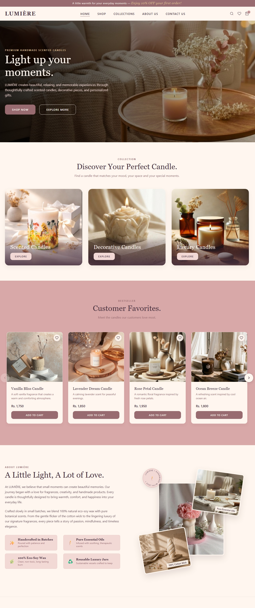
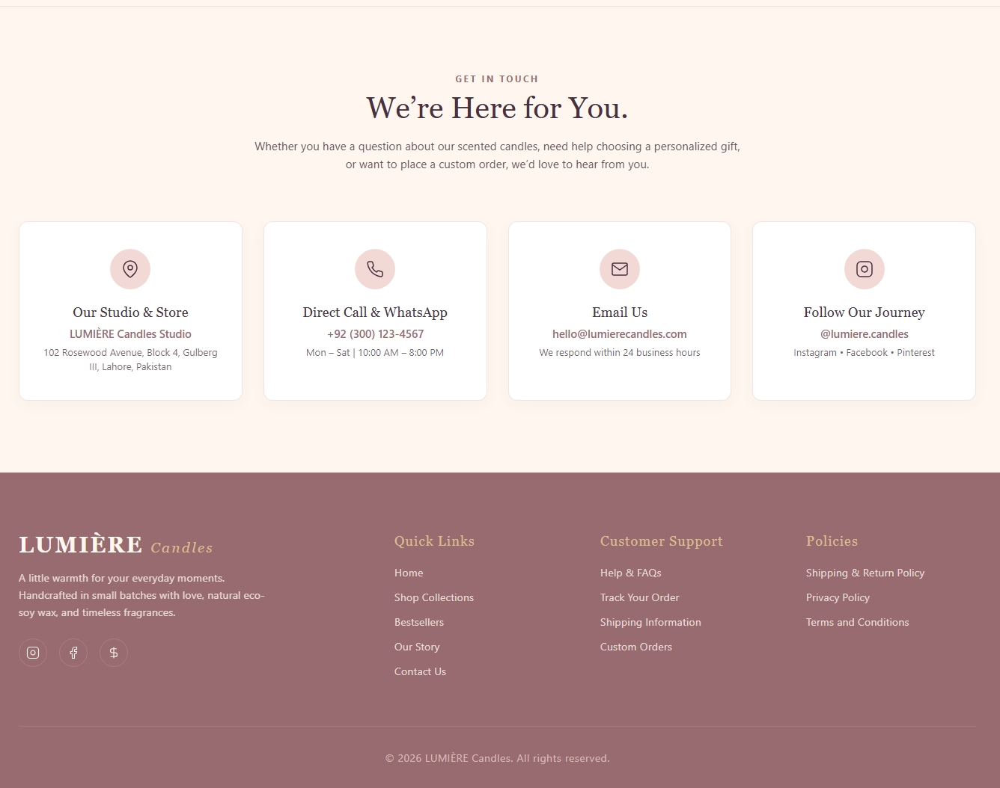
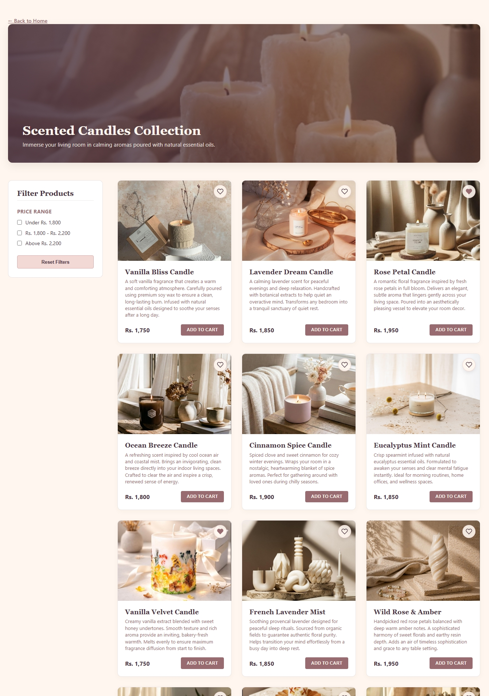
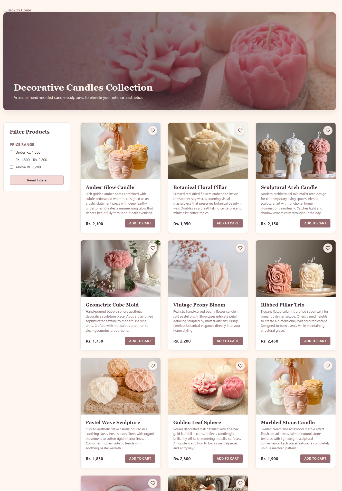
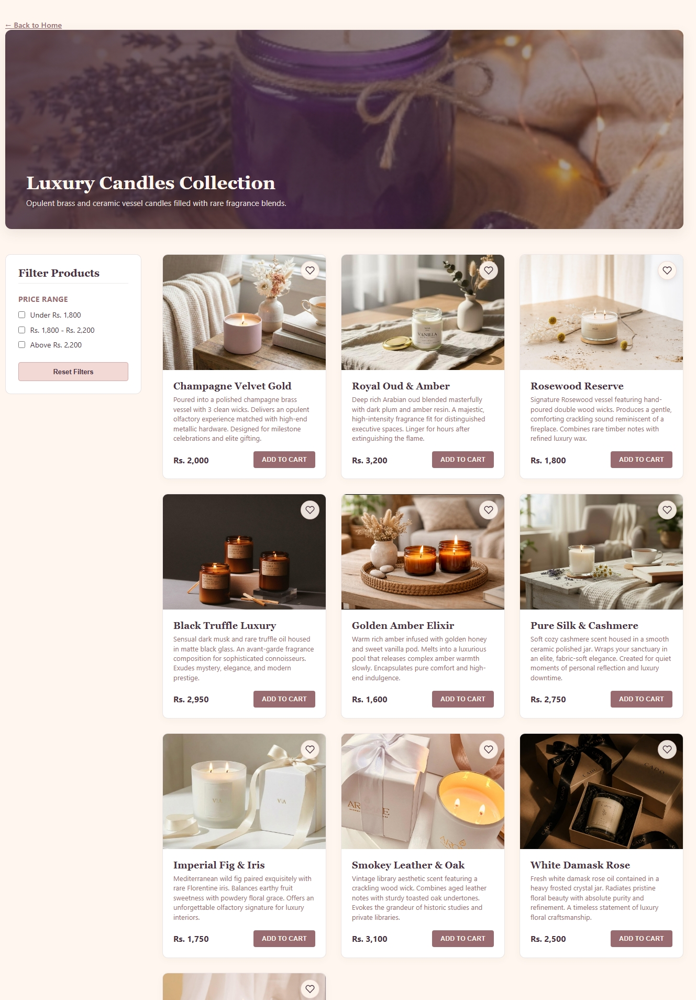
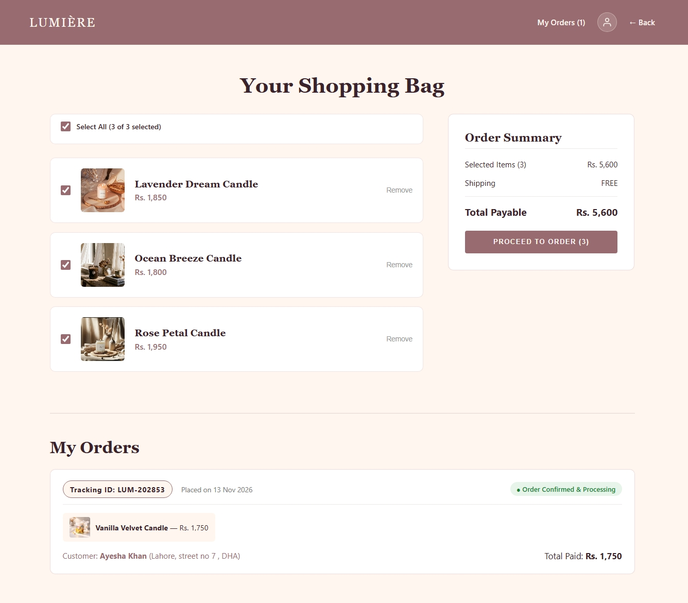
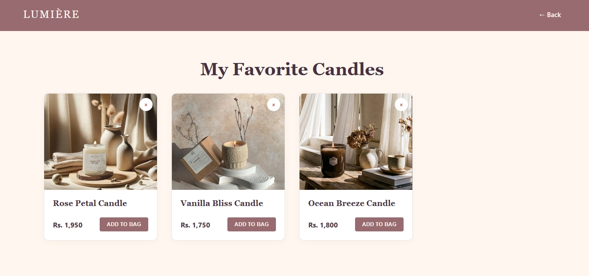

# 🕯️ LUMIÈRE – Candle Store Website

**LUMIÈRE** is a modern and elegant candle shopping website designed to provide customers with a smooth and enjoyable online shopping experience. The website allows users to explore a collection of candles, search for their favorite products, filter candles according to their preferred price range, and conveniently place orders.

The project focuses on creating a user-friendly shopping experience with interactive features and a clean, visually appealing interface.

## ✨ Features

- **🔍 Search Functionality:** Easily search for candles by entering product names or keywords.
- **🛍️ Add to Bag:** Add your favorite candles to the shopping bag and manage your selected products.
- **📦 Order Functionality:** Place orders through a simple and convenient ordering process.
- **💰 Price Range Filter:** Filter candles according to different price ranges to find products that match your budget.
- **🚚 Order Tracking:** Track order progress using a unique Tracking ID, making it easier for customers to check their order status.
- **🎨 User-Friendly Interface:** A clean, elegant, and responsive design that provides a smooth browsing experience.

## 🛠️ Technologies Used

- HTML5
- CSS3
- JavaScript

## 📸 Project Overview

LUMIÈRE brings together elegant candle shopping and practical e-commerce functionality. From discovering products to placing orders and tracking deliveries, the website offers a convenient shopping journey.

## 🎯 Project Goals

- Build an interactive e-commerce website.
- Implement practical JavaScript functionalities.
- Improve the overall user shopping experience.
- Practice product filtering, cart management, and order tracking concepts.
- Create a responsive and visually appealing website.

## Project Screenshots

